# Buildings-Generation

[](https://github.com/JIMMY081105/Buildings-Generation/actions/workflows/ci.yml)

**Simulation-ready multi-storey buildings in three styles — residential,
industrial and museum — with storey connection and falsifiable geometric
acceptance.**

<p align="center">
  
  
  
  
  
</p>

<p align="center">
  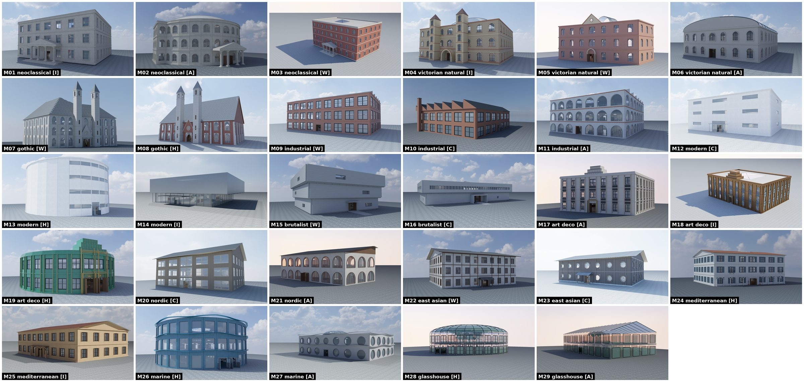
</p>
<p align="center"><em><b>Figure 1.</b> All 29 museums of the Museum29 release, path-traced in Isaac Sim (RTX).
Twelve architectural styles; the bracket gives the grand-staircase family —
<b>H</b> helical, <b>A</b> arc, <b>I</b> imperial, <b>W</b> three-flight well, <b>C</b> cantilever.</em></p>

<p align="center">
  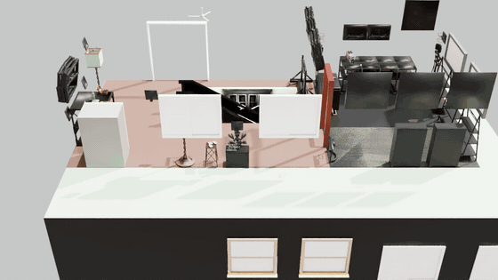
</p>
<p align="center"><em><b>Figure 2.</b> A two-storey residential building from the 54-building release
(<code>home_train96_train99_straight_v001_h270</code>, after the material pass), path-traced in Isaac Sim.
Upper-storey walls and ceilings are removed in a transient session layer so the staircase and the floor
it serves stay visible; nothing is saved and no gate runs.
<a href="docs/media/orbit_turntable.mp4">Full-resolution video</a>.</em></p>

## Abstract

Generating a building that *looks* right is easy; generating one in which a
human-scale simulated body can actually move between storeys is not, and the
failures are invisible in a render. This repository contains three building
generators and the acceptance machinery that decides whether their output is
geometrically usable. The **residential** generator stacks two different
single-storey scenes and joins them with a staircase synthesised for the
measured storey height; it produced a release of 54 two-storey houses. The
**industrial** generator tiles N × N source scenes into a single hall with a
continuous floor, a column-and-truss structure, a partial mezzanine and several
staircases, raising the walkable ground floor from about 0.1 × 10³ m² to
3.6–10.1 × 10³ m² per building; its fourth round delivered 27 accepted halls
furnished with NVIDIA SimReady equipment. The **museum** generator authors a
building from a design spec — shell, one of five grand-staircase families,
galleries and licensed scanned exhibits — and delivered 29 museums in twelve
styles with 348 path-traced photographs. All three feed a building-type-agnostic
library that detects storeys from geometry, designs and places staircases,
bakes a 5 cm occupancy cache and runs acceptance gates, each paired with a
negative control that is executed and must fail. Every result is reported with
what was measured, what would have failed, and what it does not support.

### At a glance

| | Residential | Industrial (Factory80 Round 4) | Museum (Museum29) |
|---|---:|---:|---:|
| Buildings delivered | 54 | 27 tiled halls (+ 10 stacked) | 29 |
| Storeys | 2 | 2 (ground + mezzanine) | 2–4 |
| Staircase families | straight · L · U | straight · U, metal whitelist | helical · arc · imperial · three-flight well · cantilever |
| Exact colliders per building | — | 9,354 – 217,277 (median 79,356) | per-object exact meshes |
| Reachability (0.25 m × 1.6 m body) | G25 per storey | ≥ 95.27 % on all 108 floor × class measurements | ≥ 95 % per storey (C2) |
| Physics | PhysX traversal | Isaac Sim capsule stand test (C5) | Isaac Sim drop-and-settle on treads, landings, floors (C5) |
| Photographs | Cycles / RTX | 7 per building | 12 per building, 1920 × 1080 |
| Generator snapshot | [`generation/house`](generation/house/README.md) | [`generation/factory`](generation/factory/README.md) | [`generation/museum`](generation/museum/README.md) |

## Quick start

No external data is needed: the demo builds a synthetic two-storey house and
puts it through scan, connect, bake and all seven gates.

```bash
pip install -e ".[dev]"
buildingsgen demo                          # clean house: every gate PASS, exit 0
buildingsgen demo --defect narrow_slot     # 0.30 m slot on the upper storey: G7 FAIL, exit 1
```

The second command is the point. The same pipeline, given one known fault, has
to reject the building; `--defect sealed_opening` and `--defect low_headroom`
are refused earlier, at the connect stage. Each run writes its stages, cache and
evidence to `out/demo/<clean|defect>/`, with the verdict in
`evidence/acceptance.json`.

To read further: §2 for the method, [docs/architecture.md](docs/architecture.md)
for the code's reading order, and [generation/README.md](generation/README.md)
for the generators.

## Contents

1. [Contributions](#1-contributions)
2. [Method](#2-method) — [residential](#21-residential-style) · [industrial](#22-industrial-style) · [museum](#23-museum-style) · [connection and acceptance](#24-storey-connection-and-acceptance)
3. [Results](#3-results) — [residential corpus](#31-residential-corpus) · [industrial halls](#32-industrial-halls) · [museums](#33-museums) · [what the gates see](#34-what-the-gates-see)
4. [Limitations](#4-limitations)
5. [Using the library](#5-using-the-library)
6. [Repository layout](#6-repository-layout)
7. [Assets and data sources](#7-assets-and-data-sources)
8. [Provenance and licence](#8-provenance-and-licence)
9. [Citation](#9-citation)

---

## 1. Contributions

1. **Three building generators, published verbatim.** The scripts that produced
   the residential, industrial and museum buildings are in [`generation/`](generation/README.md),
   byte-identical to the code that ran, with a SHA-256 manifest of 400 files;
   107 also match a frozen contract manifest written by the original run, and the
   45 Factory80 Round 4 tools match the SHA-256 recorded by every accepted building.
2. **A connection and acceptance library** ([`src/buildingsgen`](src/buildingsgen)):
   geometric storey detection, staircase design by riser-count search,
   placement that is verified by rasterising the flight and re-flooding before
   it is committed, an exact voxel cache, and seven gates. Building types differ
   in a YAML profile, not in the code path.
3. **A reporting discipline in which a check must be able to fail.** Every gate
   carries a negative control that runs, and a list of what its result does not
   support. The defects that motivated it are described next.

### Motivation: failures that a render does not show

- A stair whose tread plates are authored with the **underside** on the riser
  grid. The plate thickness leaks into the first step, which becomes
  0.228–0.242 m against a 0.20 m limit. The flight is unclimbable; every
  screenshot looks fine.
- A stair integrated into a building that still authors **one tread per
  riser**. Tread *n* duplicates the upper slab: two walking surfaces a
  plate-thickness apart, right at the arrival.
- A reachability check that applies the body radius only to **seed
  selection** and then floods over un-eroded connectivity. Narrow gaps stay
  connected and buildings look globally traversable. Corrected, the same 50
  buildings went from 50/50 passing to 0/50.
- A collider set cooked into **convex hulls**. A staircase becomes a ramp, and
  a ramp passes every reachability test for entirely the wrong reason.

Each of these is a check in this repository, with a negative control that must
fail.

---

## 2. Method

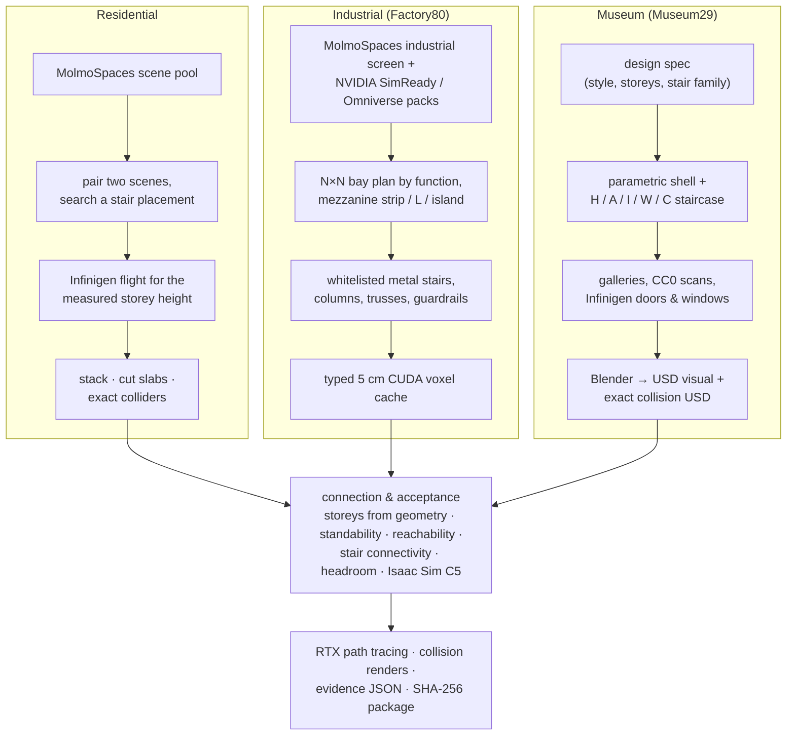

A source building is **never modified**. Every edit — stairs, slab cuts,
removed walls, colliders — is a stronger opinion in a root-layer overlay that
sublayers the untouched source, and the source hash is re-checked after every
write.

### 2.1 Residential style

Two-storey houses from two **different** MolmoSpaces scenes
([`generation/house/`](generation/house/README.md)).

| Stage | What it decides |
|---|---|
| A — pairing and placement (CPU) | Which two scenes can stack (footprint agreement; a stair-sized clear patch on Floor 1 that is also open floor on Floor 2), and where a flight of each family fits with a walkable approach behind its entry and egress ahead of its exit, a 0.60 m gap at every doorway, and no clipping. A human placement review closes the stage. |
| B — staircase assets | A flight per storey-height × family cell from Infinigen's `straight`, `l_shaped` and `u_shaped` factories, with every walking-surface rise measured on authored tread facets. |
| C — assembly | Floor 2 placed at the storey height; Floor 2 slab and Floor 1 ceiling cut around the stairwell; exact static per-object colliders; non-blocking door leaves. |
| D — validation | PhysX proof that the slab has a hole, a swept-volume traversal Floor 1 → Floor 2, CPU gates G19–G25, the multistorey navigation graph and its gate. |
| E — release | Doors opened, collisions re-inventoried, G25 re-run on exactly the released set, packaged as self-contained USDZ. |

A second pass varied the staircases' appearance. Re-shaping flights to
diversify them failed the frozen gates, so the released pass changed materials
only, re-baking Infinigen's native materials onto already audited meshes.

### 2.2 Industrial style

Stacking industrial scenes the residential way gives buildings of
111.8–238.4 m² walkable area over both storeys (median 123.4 m², ten
buildings): an apartment, not a plant. The tiled construction
([`generation/factory/`](generation/factory/README.md)) builds a hall instead:

| Element | Rule |
|---|---|
| Grid | N × N tiles, N ∈ {3, …, 7}, pitch 20 × 21 m, storey height 4.0 m; every tile a different source scene |
| Equipment | only objects with industrial, operational or warehouse evidence survive; an asset is used once per building; native scale; must fit its cell with a 1 m aisle each side |
| Floors | one continuous slab per storey in a single material; source walls, floors and ceilings deactivated |
| Mezzanine | the first k(N) cells, k = {3:4, 4:7, 5:10, 6:15, 7:21}, i.e. one third to one half of the footprint; guardrail along its outline |
| Structure | (2N + 1)² columns to a 9 m roof; a truss line per column line; roof visual only, no standable collider |
| Staircases | 2 for N ≤ 4, else 3; each in a column bay, rising through an enclosed opening in the mezzanine and arriving with ≥ 4 m of floor before the rear facade; the mezzanine supplies the last tread |
| Stair whitelist | family `straight`/`l_shaped`/`u_shaped`; step, tread **and** handrail material each `BrushedMetal` or `MetalBasic`; handrail `vertical-post`/`horizontal-post`; support `double-rail`/`solid`/`hole` |

The whitelist checks all three material parameters, not only the one in the
stair signature; a metal tread under a marble handrail has a compliant
signature and is rejected. Both of its negative controls ran and failed.

**Round 4**, the construction that produced the delivered halls
([`generation/factory/`](generation/factory/README.md)), replaces
"keep whatever equipment the tiles contain" with a deterministic plan: each bay
is assigned a function (assembly, machining, paint and clean, power, warehouse,
welding), the mezzanine takes one of three shapes (strip, L-shaped, central
island), and equipment is placed from role pools of NVIDIA SimReady, NVIDIA
Industrial and Warehouse pack and MolmoSpaces assets with aisles kept clear.
C1–C4 run on one typed 5 cm CUDA occupancy grid, C5 in Isaac Sim, and each
building ran the whole chain — assembly, voxels, C1–C5, photographs — in one
clean pass under a one-hour limit.

### 2.3 Museum style

Museums are not assembled from existing scenes. Each of the 29 buildings starts
from a design spec ([`generation/museum/specs/`](generation/museum/specs/)) that fixes
its style, footprint, storey heights and one of five grand-staircase families;
the shell, staircase, galleries and furniture are generated, and third-party
content is limited to scanned exhibits, textures and HDRI skies.

| Family | Geometry | Constraint |
|---|---|---|
| **H** grand helical | open central well, landing sectors and bridges to every slab | inner radius ≥ 1.8 m, width 1.4–1.8 m, 2.2 m between turns |
| **A** grand arc | single or horseshoe (mirrored) arc, optional mid landing | walking-line radius ≥ 4 m, width 1.6–2.4 m, 90°–180° turn |
| **I** imperial | one central flight to a landing, splitting into two return flights | centre ≥ 2.4 m wide, landing ≥ 1.6 m deep; both arrivals pass C3 |
| **W** three-flight well | three flights and two turning landings around a square well | each flight ≥ 1.4 m, well ≥ 1.0 m, guarded |
| **C** cantilever | treads built into a load-bearing collision wall, open side railed | tread 0.06–0.12 m thick; every tread an exact solid |

Wedge and arc treads are exact triangle meshes, never boxes; a landing is
required every 18 risers; every flight serves every storey. Galleries hold at
least 15 exhibits per storey on physically supported plinths and cases, and
twelve photographs per building are path-traced from the exact visual USD with
one shared exposure and tone curve. Photographs 05 and 11 share a camera — the
same stair-to-slab joint rendered and as collision geometry — so that
"the staircase reaches the floor" is shown, not asserted.

### 2.4 Storey connection and acceptance

The library in `src/buildingsgen` works on any building type.

```
 source USD ──▶ scan ──▶ connect ──▶ bake ──▶ accept ──▶ evidence JSON
                 │         │           │         │
        storeys from     stair     occupancy   G1..G7,
        geometry, not    design +  + signed    each with
        prim names       placement clearance   a control
```

| Stage | What it does | Entry point |
|---|---|---|
| `scan` | Bakes the source and reports storeys, heights and walkable area. Writes nothing to the source. | `scan_building` |
| `connect` | Designs a flight per storey pair, searches for a pose, **verifies** it by rasterising the stair and re-flooding, then authors it into a root-layer overlay. | `connect_storeys` |
| `bake` | Rasterises every enabled collider into an immutable `.scene_geometry_v1` cache. | `bake_connected` |
| `accept` | Runs the seven gates and writes one evidence record. | `accept_building` |

**Body proxy.** Standability V1 is pinned: radius 0.25 m, height 1.60 m,
support step 0.20 m, minimum component 1.00 m², voxel 5 cm. A profile that
tries to change it raises `PinnedSemanticsError`; a profile may only tighten
thresholds, never loosen them.

**Acceptance gates.**

| Gate | Question | Negative control |
|---|---|---|
| **G1** structure | Z-up, metre-scale, exact colliders, no dynamic bodies? | relabel one collider `convexHull` → must be rejected |
| **G2** cache integrity | Committed, exact-bake, self-consistent, no NaN? | tamper with the manifest → `load_cache` must raise |
| **G3** USD ↔ voxel | Does the grid agree with the geometry it represents? | displace the samples 0.5 m → recall must collapse |
| **G4** storeys and stair | Two or more plausible storeys, with a flight spanning them and headroom over it? | seal the volume above the flight → coverage must drop |
| **G5** cross-storey route | Can a 0.25 m × 1.60 m body walk from the lower storey to the upper one? | fill the shaft → the upper storey must become unreachable |
| **G6** stair rises | Is **every** rise — first, inner, last — inside the 0.20 m support step? | lower the terrain 0.15 m → the climb must break |
| **G7** body navigation | Is each storey usable from the stair, not merely touched by it? | drop the erosion → it must overstate the walkable area |

A gate has three parts, and a result missing any of them is not an
acceptance: what was measured (numbers with units), what would have failed (a
control that actually ran), and **what the result does not support**. G6 makes
the first and last rise their own measurement because they are the two an
"average riser" silently skips, and the two that break. Details:
[docs/acceptance-gates.md](docs/acceptance-gates.md).

---

## 3. Results

### 3.1 Residential corpus

| Quantity | Measured | Does not support |
|---|---|---|
| Buildings released | 54, two storeys each | that every building passes every gate; three carry recorded G25 exceptions |
| Distinct source scenes | 39 | — |
| Staircase family | straight 41 · U-shaped 9 · L-shaped 4 | a balanced family mix |
| Storey height | 3.20 m ×33 · 2.70 m ×13 · 3.00 m ×7 · 3.60 m ×1 | — |
| Staircase signature, geometric | maximum multiplicity 15; every measured re-shaped variant failed a frozen gate | that the multiplicity cannot be lowered under different gates |
| Staircase signature after the material pass (family, support, tread material, handrail, colour) | 44 buildings re-materialised; maximum multiplicity 7 | geometric diversity; the geometric gates were not re-run after the change (geometry verified byte-identical) |

| | | |
|---|---|---|
| 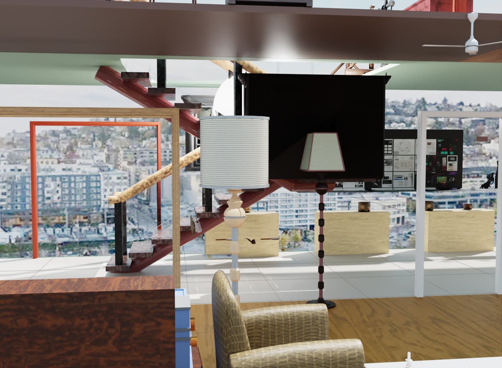 | 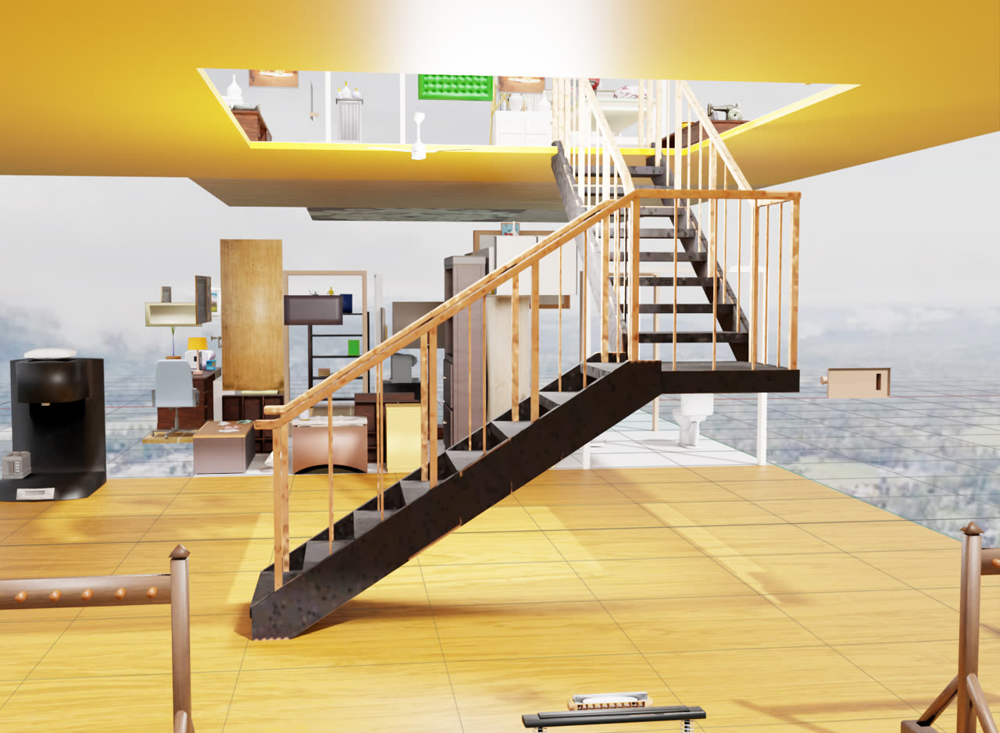 | 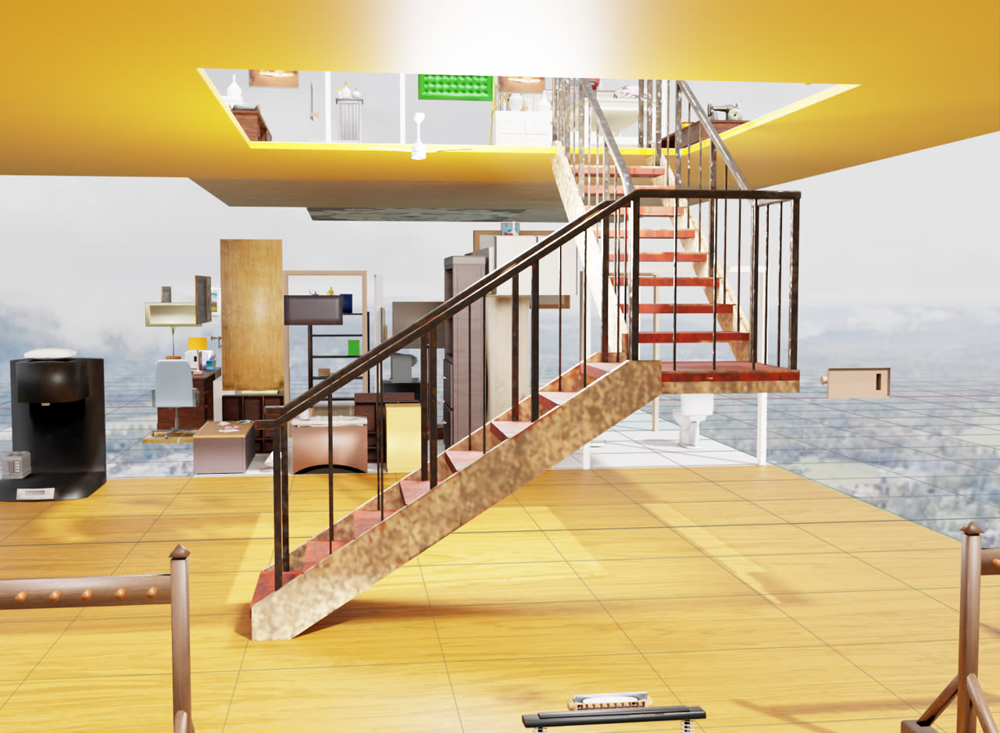 |
| **straight** | **l_shaped** | **u_shaped** |

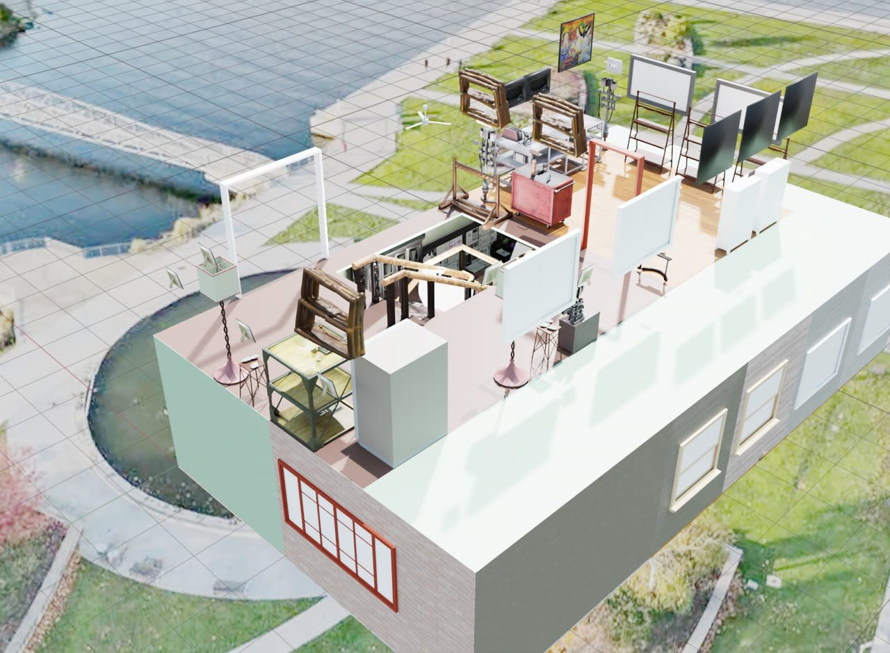

*Figure 3. Residential buildings (Cycles). Top: the three staircase families.
Bottom: a two-storey building with the upper slab cut away — the flight sits in
a furnished storey and must still clear the body proxy.*

| | |
|---|---|
| 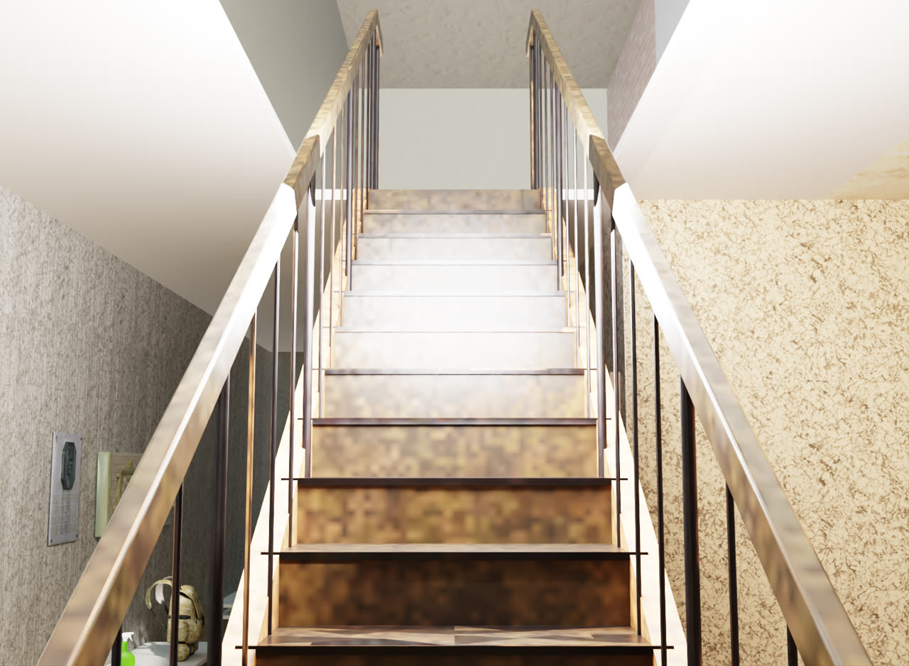 | 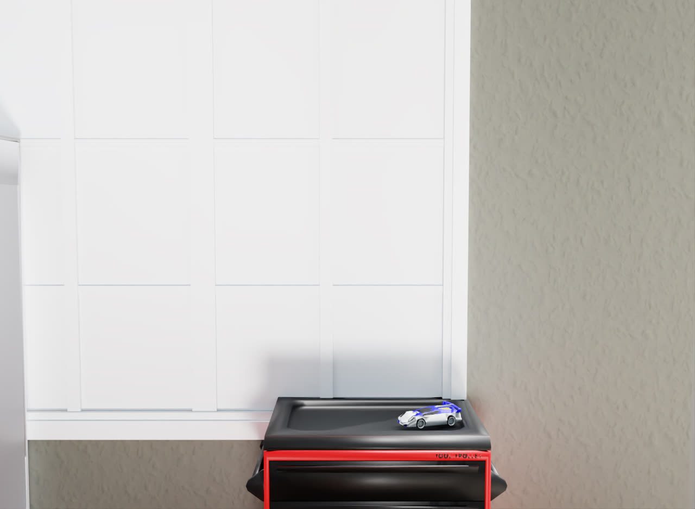 |
| **Eye level, approaching the flight** — the camera sits at 1.62 m, close to the 1.60 m height of the body proxy. | **Upper-storey arrival** — where G6 measures the last rise and G7 asks whether the storey is usable from it. |

### 3.2 Industrial halls

**Round 4 (delivered).** 27 two-storey halls are READY: C1–C5 pass on every
building, with the thresholds unchanged from the pilots.

| Quantity | Measured over the 27 READY buildings | Does not support |
|---|---|---|
| Exact static colliders (C1) | 9,354 – 217,277, median 79,356; manifest count equals cooked count | — |
| Placed equipment instances | 294 – 1,205, median 595 | that equipment is semantically arranged beyond its bay function |
| Same-bay and cross-bay reachability (C2) | minimum 95.27 % over 108 floor × class measurements (threshold 95 %) | dynamic traversal by a controller |
| Stair connectivity and headroom (C3, C4) | PASS on every staircase; ≥ 90 % of each tread with 1.6 m headroom | — |
| Native capsule stand test (C5) | PASS on every building | balance or gait |
| End-to-end clean run | 644 – 3,500 s, median 1,487 s, limit 3,600 s | — |

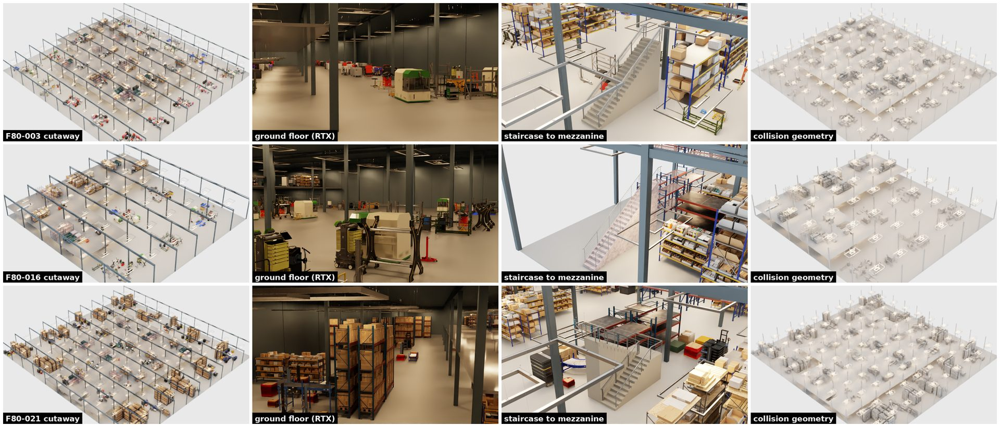

*Figure 4. Three Round 4 halls (rows). From left: cutaway from above, ground
floor (RTX), a staircase to the mezzanine, and the same building as pure
collision geometry. Equipment is NVIDIA SimReady and Omniverse pack assets.*

**Pilots (history).** Six two-storey tiled pilots, as measured on 2026-10-13,
before Round 4.

| Building | Grid / stairs | Slab area F1 / F2 (m²) | Mezzanine coverage | Distinct scenes / equipment | Columns / truss members / roof | Standable F1 / F2 (m²) | Frozen G25 |
|---|---|---|---|---|---|---|---|
| 001 | 3×3 / 2 | 3780 / 1658 | 43.9 % | 13 / 138 | 49 / 56 / 1 | 3559 / 1562 | PASS / PASS |
| 002 | 4×4 / 2 | 6720 / 2879 | 42.8 % | 23 / 186 | 81 / 90 / 1 | 6394 / 2774 | PASS / PASS |
| 003 | 5×5 / 3 | 10500 / 4156 | 39.6 % | 35 / 225 | 121 / 132 / 1 | 10051 / 4016 | PASS / PASS |
| 004 | 3×3 / 2 | 3780 / 1653 | 43.7 % | 13 / 138 | 49 / 56 / 1 | 3555 / 1561 | PASS / PASS |
| 005 | 4×4 / 2 | 6720 / 2880 | 42.9 % | 23 / 188 | 81 / 90 / 1 | 6374 / 2771 | PASS / PASS |
| 006 | 5×5 / 3 | 10500 / 4147 | 39.5 % | 35 / 225 | 121 / 132 / 1 | 10064 / 4010 | PASS / PASS |

All six have one floor material and no repeated equipment asset (by asset
identity, not geometric similarity). **Does not support:** body-eroded routes,
physics, image quality, or acceptance of any building. On the same pilots,
Isaac Stage D passed 1 of 6 buildings, the image-quality gates excluded 34 of
52 stills, and the hall was judged visually unconvincing in all six — a large
open floor with sparse, small equipment — the weakness Round 4 addressed.

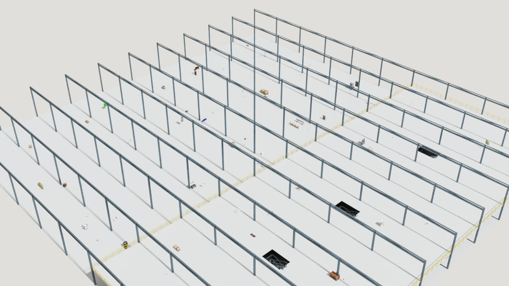

*Figure 5. Pilot 003 (5 × 5 tiles, three staircases), RTX, roof removed.
Columns and truss lines on the half-pitch grid, the mezzanine and its
guardrail, and three stairwells. The sparse equipment is the measured weakness
noted above, not an artefact of the render.*

| | |
|---|---|
| 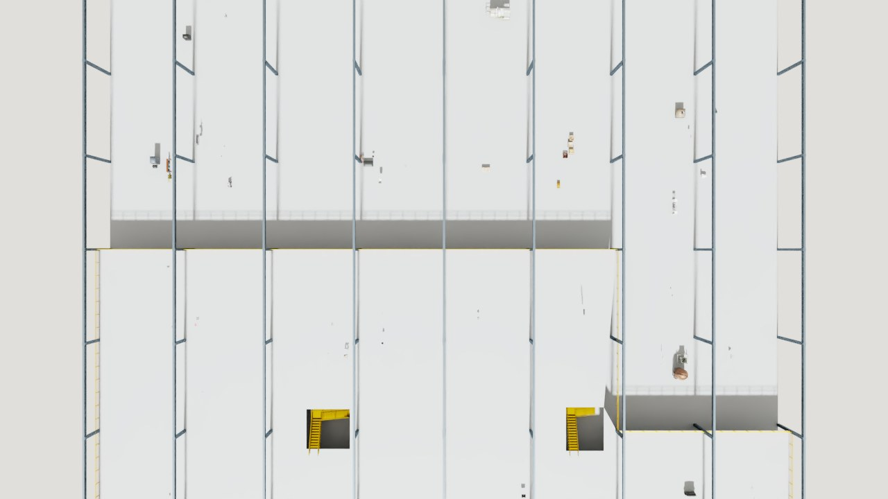 | 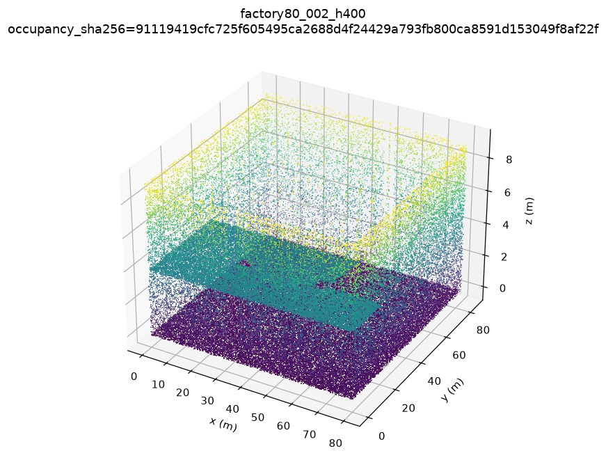 |
| **Pilot 002, top-down cut.** The L-shaped mezzanine over part of the hall, and the two stairwells cut through it. | **The same building as 5 cm occupancy.** Ground slab, mezzanine at 4 m, structure to 9 m. |

### 3.3 Museums

29 museums, 2–4 storeys (12 × 2, 15 × 3, 2 × 4), twelve styles, staircase
families H 6 · A 7 · I 5 · W 6 · C 5. Every building passes C1–C5; 348
photographs are path-traced at 1920 × 1080.

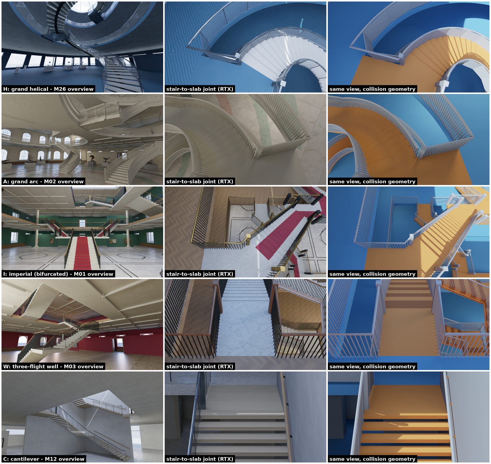

*Figure 6. The five staircase families. Left: overview. Centre: the
stair-to-slab joint, path-traced. Right: the same camera on the collision
geometry — stairs orange, slabs blue, everything else grey. The top treads must
visibly meet the slab in both.*

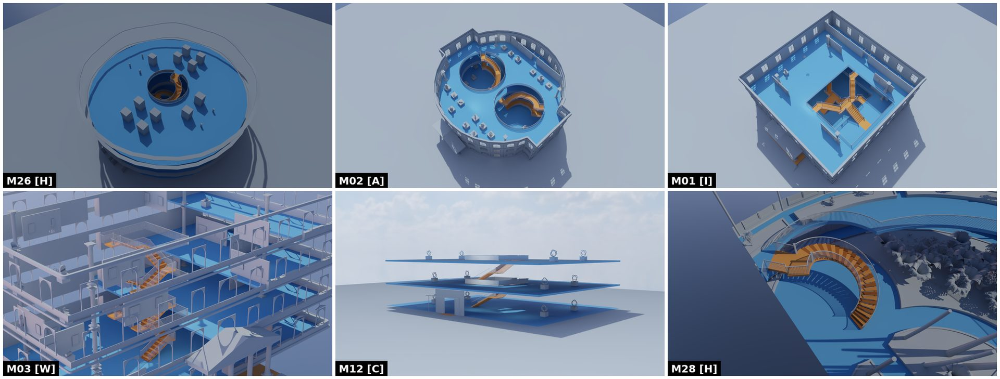

*Figure 7. Collision cut-aways through every storey (photograph 12): the
staircase must be continuous from the ground slab to the top storey, and no
visual mesh may leak into the collision render.*

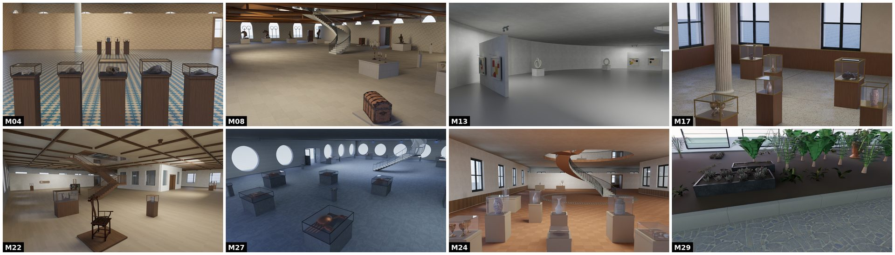

*Figure 8. Galleries. Exhibits are CC0 scans (Smithsonian, Poly Haven), CC0
artworks (Cleveland Museum of Art) and procedurally generated originals, on
supported plinths and in 2 cm-framed glass cases.*

| Quantity | Measured | Does not support |
|---|---|---|
| Buildings, all gates | 26 PASS; 3 PASS with user-approved exceptions (M21, M25, M29) | that interiors match the Blender lighting design (see §4) |
| Colour exceptions | 10 exhibits, each failing only the saturation-ratio ≥ 0.5 gate; listed per item in `KNOWN_EXCEPTIONS.json` | — |
| Photograph uniqueness | 348 / 348 PNG SHA-256 distinct | — |
| Package integrity | 10,614 files, `sha256sum -c` OK on all 29 current packages | — |
| Diversity (D1) | 29 distinct style × staircase × plan × ground-material combinations; each staircase family in ≥ 4 buildings | perceptual diversity |

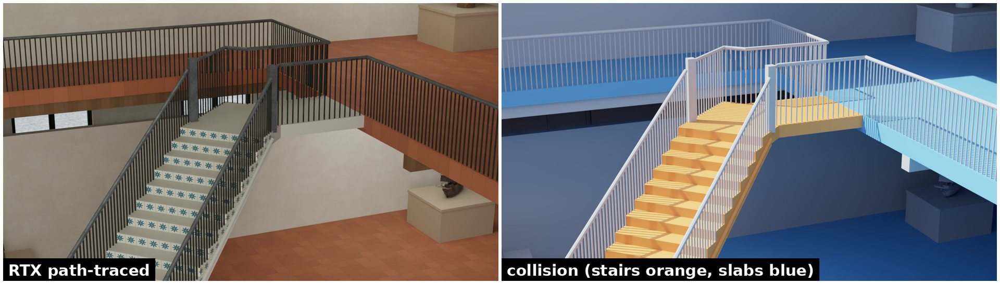

*Figure 9. M25 (Mediterranean, imperial staircase): the stair-to-slab joint,
path-traced (left) and as collision geometry from the same camera (right).*

### 3.4 What the gates see

<table>
<tr>
<td width="50%">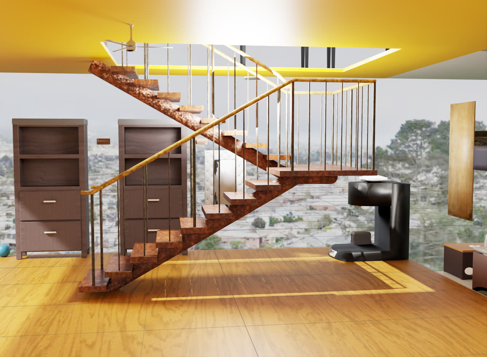</td>
<td width="50%">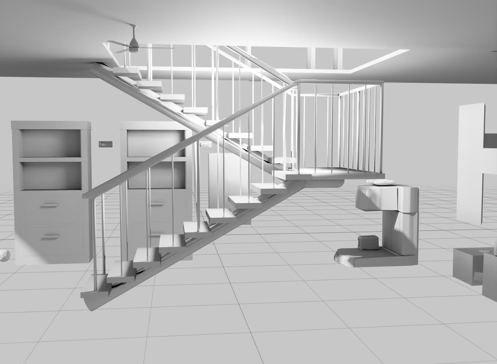</td>
</tr>
<tr><td><b>Render</b></td><td><b>Collision geometry</b></td></tr>
</table>

The same viewpoint, shaded and as colliders. Acceptance runs on the right-hand
image, never the left: a scene can look finished and still be built from convex
hulls that turn a staircase into a ramp.

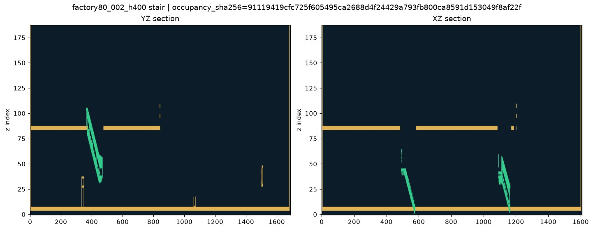

*Figure 10. Pilot 002 in section through its stairwells, in 5 cm voxel indices.
Gold: the ground slab and the mezzanine slab with its openings; green: stair
geometry.*

**Why the cache is 3D, not a height map.**

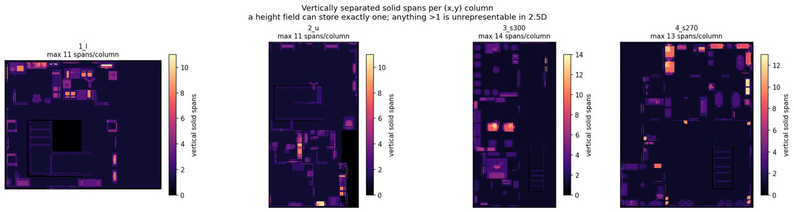

A 2.5D height field stores one surface per `(x, y)` cell. In these buildings
**17–21 % of occupied columns carry two or more vertical solid spans** — a stair
under a landing, a mezzanine over a floor, a double-height void. Those columns
are not *approximated* by a height map; they are unrepresentable in it.

| building | occupied columns | columns with ≥ 2 spans | max spans in one column |
|---|---:|---:|---:|
| `1_l` | 38,313 | 6,551 (17.1 %) | 11 |
| `2_u` | 45,082 | 7,874 (17.5 %) | 11 |
| `3_s300` | 65,668 | 13,651 (20.8 %) | 14 |
| `4_s270` | 72,897 | 12,450 (17.1 %) | 13 |

---

## 4. Limitations

- **Geometric acceptance only.** No contact dynamics, no balance, no actuation.
  A PASS says the building is not disqualified by its geometry; it does not say
  that any controller can traverse it.
- **Industrial pilots were not accepted; Round 4 was.** The six tiled pilots
  met their area, coverage, single-material and G25 targets but failed Isaac
  Stage D, the image-quality gates and visual review (§3.2). Round 4 changed the
  construction and delivered 27 accepted halls; 13 further layouts were
  excluded on real layout failures rather than re-run with looser rules.
- **Museum interiors are under-lit by design lamps.** The legacy exporter
  writes Blender AREA lights as USD `DiskLight` with `intensity = 1.5 × power`
  and `normalize = false`, while Cycles normalises AREA power by emitter area.
  In an unoccluded analytic model of five exhibit positions (M21) the
  AREA-to-sky ratio in USD is about 2 % of the Blender design, so interiors
  are lit mostly by the sky dome. This is not corrected in the release; it is
  the stated cause of the 10 colour exceptions in §3.3, and it was not measured
  directly in the renderer.
- **A frozen check had a blind spot.** A negative control (N1-3) showed that
  removing every stair edge from the navigation graph does not prove that the
  storeys depend on the stairs: a non-stair opening plus a ramp kept them
  connected, and the check passed. An additional control (A3-V) now covers that
  case; it is not in the snapshot.
- **The industrial screen is textual.** Source equipment is selected by phrase
  matches on object annotations, not by measured size.
- **Two body envelopes.** Placement search uses a 0.22 m radius and 1.75 m
  height; every gate uses Standability V1 (0.25 m, 1.60 m). They are not
  interchangeable.
- **The generation snapshot is environment-bound** — absolute cluster paths,
  Isaac Sim, Blender/Infinigen, external corpora. It documents the procedure;
  re-running a step is a new run.
- **Subjective ratings are subjective.** Visual judgements are reported as such
  and never as measurements.

---

## 5. Using the library

```bash
pip install -e ".[dev]"        # core + tests
pip install -e ".[figures]"    # + matplotlib for report figures
pip install -e ".[stairs]"     # + Blender/Infinigen for detailed stair assets
```

Core needs only `numpy`, `scipy`, `trimesh`, `rtree`, `usd-core` and `PyYAML`. The
dependency-light stair backend (`buildingsgen.stairs.asset`) is pure OpenUSD
and is what the tests use; Infinigen is optional and gives richer assets
through the same interface.

### Command line

```bash
buildingsgen types                              # what profiles exist
buildingsgen scan    building.usd --type school
buildingsgen stairs  --rise 3.4 --type school --out stair.usda
buildingsgen connect building.usd --type school --workspace out/school_a
buildingsgen accept  --workspace out/school_a --stair-prim /World/Stair_0
buildingsgen run     building.usd --type factory      # all of the above
buildingsgen demo    [--defect narrow_slot]           # all of the above on a synthetic house
```

Every subcommand writes a machine-readable record under the workspace, so a
number can be cited later without rerunning anything.

### Python

```python
from buildingsgen import Workspace, load_profile, run_all

profile = load_profile("factory")
workspace = Workspace(root="out/plant_01", name="plant_01")
record = run_all("corpora/plant_01.usd", workspace, profile)

print(record["acceptance"]["status"])
for result in record["acceptance"]["results"]:
    print(result["gate"], result["status"], result["failures"])
```

```
out/plant_01/
    stages/   plant_01_connected.usda   overlay: stairs only, source untouched
              plant_01_flat.usda        composed stage the gates read
    caches/   plant_01_connected.scene_geometry_v1/
    assets/   plant_01_stair_0/stair.usda + traversal_path.json
    evidence/ scan.json connect.json bake.json acceptance.json
```

### Building types

```yaml
# src/buildingsgen/profiles/factory.yaml
name: factory
extends: generic
stair:
  families: [straight, u_shaped]
  preferred_riser_m: 0.185      # steeper industrial flights
  width_m: 1.20
  handrail: double
storeys:
  min_storey_height_m: 3.20     # tall halls, mezzanines
acceptance:
  min_reachable_area_per_storey_m2: 25.0
  max_unreachable_standable_component_m2: 3.0
```

Shipped profiles: `generic`, `house`, `factory`, `school`, `warehouse`,
`office`. Adding one is a YAML file — see [docs/building-types.md](docs/building-types.md).
Storey detection is geometric — a histogram of walkable heights, not prim
names — and a test renames the roots to prove it.

### Tests

```bash
pytest                  # unit tests and the snapshot integrity check, seconds
pytest --runslow        # + end-to-end runs on synthetic buildings, minutes
```

The slow tests build synthetic buildings with **known** defects and assert the
pipeline rejects them: a sealed slab cannot be connected, a 1.2 m ceiling is
not a storey, a 0.30 m slot does not make a storey reachable.
`tests/test_generation_snapshot.py` re-hashes `generation/` against its
manifest, and two negative controls show that it detects a changed byte and an
unlisted file.

---

## 6. Repository layout

```
src/buildingsgen/       the library
    config.py           building-type profiles, inheritance, threshold direction
    pipeline.py         scan / connect / bake / accept, and placement verification
    usd/                stage + overlay rules, colliders, geometric storey detection
    stairs/             design (spec), USD asset, placement search, Infinigen backend
    voxel/              grid, rasteriser, cache format, Standability V1
    acceptance/         gate results, context, the seven gates, runner
    fixtures/           synthetic buildings, with and without defects
    profiles/           generic, house, factory, school, warehouse, office
generation/             verbatim generator snapshot (read-only)
    house/              residential: pairing, staircases, assembly, validation, release
    factory/            industrial: bay layout, assembly, CUDA voxels, C1–C5, RTX, packaging
    museum/             museums: specs, shell + five staircase families, galleries,
                        USD export, Isaac C5 / RTX, static validators
    archive/            earlier industrial pilots (sourcing, stacked, tiled)
    MANIFEST.json       size, SHA-256 and origin of every file; exclusions with reasons
docs/                   architecture, building types, acceptance gates, provenance
    assets.md           every third-party asset with source and licence (generated)
    assets/             machine-readable asset records behind assets.md
    media/              figures used in this README
tools/
    build_asset_catalog.py   regenerates docs/assets.md; --check fails when stale
tests/
```

Reading order: [docs/architecture.md](docs/architecture.md) for the library,
[generation/README.md](generation/README.md) for the generators.

## 7. Assets and data sources

No third-party asset is redistributed; the generators download each one at run
time. [docs/assets.md](docs/assets.md) lists every asset with its source URL
and licence.

| Source | Used in | Count | Licence |
|---|---|---:|---|
| [MolmoSpaces](https://huggingface.co/datasets/allenai/molmospaces) (AI2; Holodeck / Objaverse scenes and objects) | residential and stacked-factory source scenes; Factory80 objects | 39 scenes (residential); 72 objects (Factory80) | per dataset card / per object |
| [Infinigen](https://github.com/princeton-vl/infinigen) | residential and stacked-factory staircases; museum doors, casings, pillars, windows | — | BSD-3-Clause |
| [NVIDIA SimReady assets](https://huggingface.co/datasets/nvidia/simready-assets) | Factory80 equipment | 190 eligible of 203 | CC-BY-4.0 |
| NVIDIA Industrial / Warehouse / USD Explorer packs | Factory80 racking, structure, props | 84 | NVIDIA Omniverse terms |
| [Cleveland Museum of Art](https://www.clevelandart.org/open-access) open access | Museum29 artworks | 180 | CC0-1.0 |
| [Poly Haven](https://polyhaven.com) | Museum29 textures, HDRI skies, scanned props | 116 | CC0-1.0 |
| [Smithsonian 3D](https://3d.si.edu) open access | Museum29 scanned exhibits | 41 | CC0-1.0 |
| [ambientCG](https://ambientcg.com) | Museum29 materials | 15 | CC0-1.0 |
| Project-authored | procedural geometry, baked textures, original artwork | 387 (museum) + 6 (factory) | this repository's licence |

SimReady attribution: *"NVIDIA simready-assets", NVIDIA, CC-BY-4.0* — changed
here by unit and axis normalisation, ground alignment, static collision proxies
and disabled dynamic physics.

## 8. Provenance and licence

Apache-2.0. Parts of the voxel and standability code derive from NVIDIA
ProtoMotions (Apache-2.0); the stair backends call Infinigen (BSD-3-Clause)
without vendoring it; source scenes come from MolmoSpaces and are not
redistributed. [NOTICE](NOTICE) and [docs/provenance.md](docs/provenance.md)
list every derived file and what changed; [generation/MANIFEST.json](generation/MANIFEST.json)
gives the origin of every snapshot file.

## 9. Citation

```bibtex
@software{ma2026buildingsgeneration,
  author  = {Ma, Yixing},
  title   = {{Buildings-Generation}: Simulation-Ready Multi-Storey Residential,
             Industrial and Museum Buildings with Falsifiable Geometric Acceptance},
  year    = {2026},
  version = {0.2.0},
  url     = {https://github.com/JIMMY081105/Buildings-Generation}
}
```

This work builds on:

- **Infinigen Indoors** — A. Raistrick et al., *Infinigen Indoors: Photorealistic
  Indoor Scenes using Procedural Generation*, CVPR 2024. Staircase factories.
- **Holodeck** — Y. Yang et al., *Holodeck: Language Guided Generation of 3D
  Embodied AI Environments*, CVPR 2024; and **Objaverse** — M. Deitke et al.,
  *Objaverse: A Universe of Annotated 3D Objects*, CVPR 2023. Origin of the
  `holodeck-objaverse` scenes and assets.
- **MolmoSpaces** — Allen Institute for AI, <https://huggingface.co/datasets/allenai/molmospaces>.
  Scene and object packages.
- **ProtoMotions** — NVIDIA, <https://github.com/NVlabs/ProtoMotions>. Voxel cache
  layout and standability semantics.
- **OpenUSD** — Pixar, <https://github.com/PixarAnimationStudios/OpenUSD>; and
  **NVIDIA Isaac Sim** for PhysX validation and RTX rendering.
- **NVIDIA SimReady assets** — <https://huggingface.co/datasets/nvidia/simready-assets>,
  CC-BY-4.0. Industrial equipment in Factory80.
- **Poly Haven**, **ambientCG**, **Smithsonian 3D Digitization** and the
  **Cleveland Museum of Art** open-access programme — CC0 textures, HDRIs,
  scans and artworks in Museum29.
