# Buildings-Generation

**Simulation-ready multi-storey buildings in two styles — residential and
industrial — with storey connection and falsifiable geometric acceptance.**

<p align="center">
  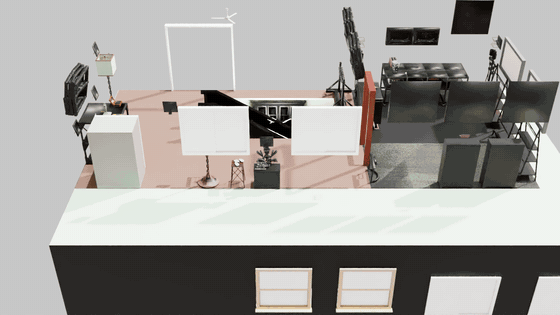
</p>
<p align="center"><em><b>Figure 1.</b> A two-storey residential building from the 54-building release
(<code>home_train96_train99_straight_v001_h270</code>, after the material pass), path-traced in Isaac Sim.
Upper-storey walls and ceilings are removed in a transient session layer so the staircase and the floor
it serves stay visible; nothing is saved and no gate runs.
<a href="docs/media/orbit_turntable.mp4">Full-resolution video</a>.</em></p>

## Abstract

Generating a building that *looks* right is easy; generating one in which a
human-scale simulated body can actually move between storeys is not, and the
failures are invisible in a render. This repository contains two building
generators and the acceptance machinery that decides whether their output is
geometrically usable. The **residential** generator stacks two different
single-storey scenes and joins them with a staircase synthesised for the
measured storey height; it produced a release of 54 two-storey houses. The
**industrial** generator tiles N × N source scenes into a single hall with a
continuous floor, a column-and-truss structure, a partial mezzanine and
several staircases, raising the walkable ground floor from about 0.1 × 10³ m²
to 3.6–10.1 × 10³ m² per building; it is in progress, and none of its
buildings is yet accepted. Both feed a building-type-agnostic library that
detects storeys from geometry, designs and places staircases, bakes a 5 cm
occupancy cache and runs seven acceptance gates, each paired with a negative
control that is executed and must fail. Every result is reported with what was
measured, what would have failed, and what it does not support.

## Contents

1. [Contributions](#1-contributions)
2. [Method](#2-method) — [residential](#21-residential-style) · [industrial](#22-industrial-style) · [connection and acceptance](#23-storey-connection-and-acceptance)
3. [Results](#3-results) — [residential corpus](#31-residential-corpus) · [industrial pilots](#32-industrial-pilots) · [what the gates see](#33-what-the-gates-see)
4. [Limitations](#4-limitations)
5. [Using the library](#5-using-the-library)
6. [Repository layout](#6-repository-layout)
7. [Provenance and licence](#7-provenance-and-licence)
8. [Citation](#8-citation)

---

## 1. Contributions

1. **Two building generators, published verbatim.** The scripts that produced
   the residential and industrial buildings are in [`generation/`](generation/README.md),
   byte-identical to the code that ran, with a SHA-256 manifest; 107 of the 256
   files also match a frozen contract manifest written by the original run.
2. **A connection and acceptance library** ([`src/buildingsgen`](src/buildingsgen)):
   geometric storey detection, staircase design by riser-count search,
   placement that is verified by rasterising the flight and re-flooding before
   it is committed, an exact voxel cache, and seven gates. Building types differ
   in a YAML profile, not in the code path.
3. **A reporting discipline in which a check must be able to fail.** Every gate
   carries a negative control that runs, and a list of what its result does not
   support. The defects that motivated it are described next.

### Motivation: failures that a render does not show

- A stair whose tread plates are authored with the **underside** on the riser
  grid. The plate thickness leaks into the first step, which becomes
  0.228–0.242 m against a 0.20 m limit. The flight is unclimbable; every
  screenshot looks fine.
- A stair integrated into a building that still authors **one tread per
  riser**. Tread *n* duplicates the upper slab: two walking surfaces a
  plate-thickness apart, right at the arrival.
- A reachability check that applies the body radius only to **seed
  selection** and then floods over un-eroded connectivity. Narrow gaps stay
  connected and buildings look globally traversable. Corrected, the same 50
  buildings went from 50/50 passing to 0/50.
- A collider set cooked into **convex hulls**. A staircase becomes a ramp, and
  a ramp passes every reachability test for entirely the wrong reason.

Each of these is a check in this repository, with a negative control that must
fail.

---

## 2. Method

```
 residential                          industrial
 ───────────                          ──────────
 scene pool (MolmoSpaces)             scene pool (MolmoSpaces, industrial screen)
   │ pair two scenes                    │ plan an N×N grid, all tiles distinct
   │ search a stair placement           │ author one root-layer overlay:
   │ synthesise the flight (Infinigen)  │   tiles · floors · mezzanine · structure
   │ stack, cut slabs, exact colliders  │   whitelisted stairs (Infinigen) · rails
   ▼                                    ▼
 ┌─────────────────────────────────────────────────────────────────────┐
 │ connection and acceptance: storeys from geometry · 5 cm occupancy   │
 │ cache · standability · G1–G7 (+ the generators' own frozen gates)   │
 └─────────────────────────────────────────────────────────────────────┘
                                    │
                          evidence JSON per building
```

A source building is **never modified**. Every edit — stairs, slab cuts,
removed walls, colliders — is a stronger opinion in a root-layer overlay that
sublayers the untouched source, and the source hash is re-checked after every
write.

### 2.1 Residential style

Two-storey houses from two **different** MolmoSpaces scenes
([`generation/house/`](generation/house/README.md)).

| Stage | What it decides |
|---|---|
| A — pairing and placement (CPU) | Which two scenes can stack (footprint agreement; a stair-sized clear patch on Floor 1 that is also open floor on Floor 2), and where a flight of each family fits with a walkable approach behind its entry and egress ahead of its exit, a 0.60 m gap at every doorway, and no clipping. A human placement review closes the stage. |
| B — staircase assets | A flight per storey-height × family cell from Infinigen's `straight`, `l_shaped` and `u_shaped` factories, with every walking-surface rise measured on authored tread facets. |
| C — assembly | Floor 2 placed at the storey height; Floor 2 slab and Floor 1 ceiling cut around the stairwell; exact static per-object colliders; non-blocking door leaves. |
| D — validation | PhysX proof that the slab has a hole, a swept-volume traversal Floor 1 → Floor 2, CPU gates G19–G25, the multistorey navigation graph and its gate. |
| E — release | Doors opened, collisions re-inventoried, G25 re-run on exactly the released set, packaged as self-contained USDZ. |

A second pass varied the staircases' appearance. Re-shaping flights to
diversify them failed the frozen gates, so the released pass changed materials
only, re-baking Infinigen's native materials onto already audited meshes.

### 2.2 Industrial style

Stacking industrial scenes the residential way gives buildings of
111.8–238.4 m² walkable area over both storeys (median 123.4 m², ten
buildings): an apartment, not a plant. The tiled construction
([`generation/factory/`](generation/factory/README.md)) builds a hall instead:

| Element | Rule |
|---|---|
| Grid | N × N tiles, N ∈ {3, …, 7}, pitch 20 × 21 m, storey height 4.0 m; every tile a different source scene |
| Equipment | only objects with industrial, operational or warehouse evidence survive; an asset is used once per building; native scale; must fit its cell with a 1 m aisle each side |
| Floors | one continuous slab per storey in a single material; source walls, floors and ceilings deactivated |
| Mezzanine | the first k(N) cells, k = {3:4, 4:7, 5:10, 6:15, 7:21}, i.e. one third to one half of the footprint; guardrail along its outline |
| Structure | (2N + 1)² columns to a 9 m roof; a truss line per column line; roof visual only, no standable collider |
| Staircases | 2 for N ≤ 4, else 3; each in a column bay, rising through an enclosed opening in the mezzanine and arriving with ≥ 4 m of floor before the rear facade; the mezzanine supplies the last tread |
| Stair whitelist | family `straight`/`l_shaped`/`u_shaped`; step, tread **and** handrail material each `BrushedMetal` or `MetalBasic`; handrail `vertical-post`/`horizontal-post`; support `double-rail`/`solid`/`hole` |

The whitelist checks all three material parameters, not only the one in the
stair signature; a metal tread under a marble handrail has a compliant
signature and is rejected. Both of its negative controls ran and failed.

### 2.3 Storey connection and acceptance

The library in `src/buildingsgen` works on any building type.

```
 source USD ──▶ scan ──▶ connect ──▶ bake ──▶ accept ──▶ evidence JSON
                 │         │           │         │
        storeys from     stair     occupancy   G1..G7,
        geometry, not    design +  + signed    each with
        prim names       placement clearance   a control
```

| Stage | What it does | Entry point |
|---|---|---|
| `scan` | Bakes the source and reports storeys, heights and walkable area. Writes nothing to the source. | `scan_building` |
| `connect` | Designs a flight per storey pair, searches for a pose, **verifies** it by rasterising the stair and re-flooding, then authors it into a root-layer overlay. | `connect_storeys` |
| `bake` | Rasterises every enabled collider into an immutable `.scene_geometry_v1` cache. | `bake_connected` |
| `accept` | Runs the seven gates and writes one evidence record. | `accept_building` |

**Body proxy.** Standability V1 is pinned: radius 0.25 m, height 1.60 m,
support step 0.20 m, minimum component 1.00 m², voxel 5 cm. A profile that
tries to change it raises `PinnedSemanticsError`; a profile may only tighten
thresholds, never loosen them.

**Acceptance gates.**

| Gate | Question | Negative control |
|---|---|---|
| **G1** structure | Z-up, metre-scale, exact colliders, no dynamic bodies? | relabel one collider `convexHull` → must be rejected |
| **G2** cache integrity | Committed, exact-bake, self-consistent, no NaN? | tamper with the manifest → `load_cache` must raise |
| **G3** USD ↔ voxel | Does the grid agree with the geometry it represents? | displace the samples 0.5 m → recall must collapse |
| **G4** storeys and stair | Two or more plausible storeys, with a flight spanning them and headroom over it? | seal the volume above the flight → coverage must drop |
| **G5** cross-storey route | Can a 0.25 m × 1.60 m body walk from the lower storey to the upper one? | fill the shaft → the upper storey must become unreachable |
| **G6** stair rises | Is **every** rise — first, inner, last — inside the 0.20 m support step? | lower the terrain 0.15 m → the climb must break |
| **G7** body navigation | Is each storey usable from the stair, not merely touched by it? | drop the erosion → it must overstate the walkable area |

A gate has three parts, and a result missing any of them is not an
acceptance: what was measured (numbers with units), what would have failed (a
control that actually ran), and **what the result does not support**. G6 makes
the first and last rise their own measurement because they are the two an
"average riser" silently skips, and the two that break. Details:
[docs/acceptance-gates.md](docs/acceptance-gates.md).

---

## 3. Results

### 3.1 Residential corpus

| Quantity | Measured | Does not support |
|---|---|---|
| Buildings released | 54, two storeys each | that every building passes every gate; three carry recorded G25 exceptions |
| Distinct source scenes | 39 | — |
| Staircase family | straight 41 · U-shaped 9 · L-shaped 4 | a balanced family mix |
| Storey height | 3.20 m ×33 · 2.70 m ×13 · 3.00 m ×7 · 3.60 m ×1 | — |
| Staircase signature, geometric | maximum multiplicity 15; every measured re-shaped variant failed a frozen gate | that the multiplicity cannot be lowered under different gates |
| Staircase signature after the material pass (family, support, tread material, handrail, colour) | 44 buildings re-materialised; maximum multiplicity 7 | geometric diversity; the geometric gates were not re-run after the change (geometry verified byte-identical) |

| | | |
|---|---|---|
| 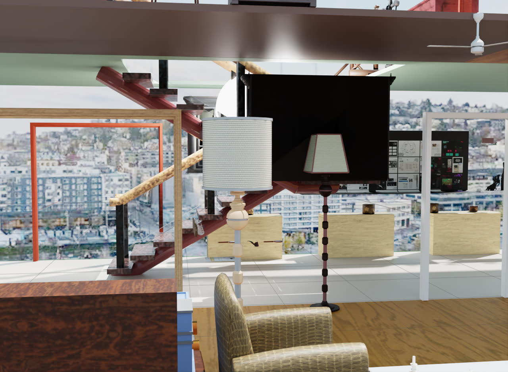 | 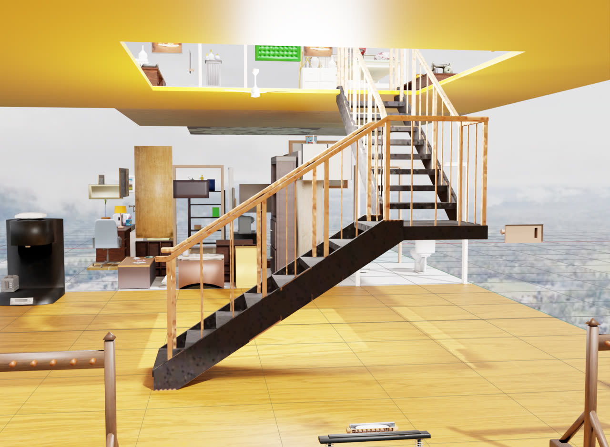 | 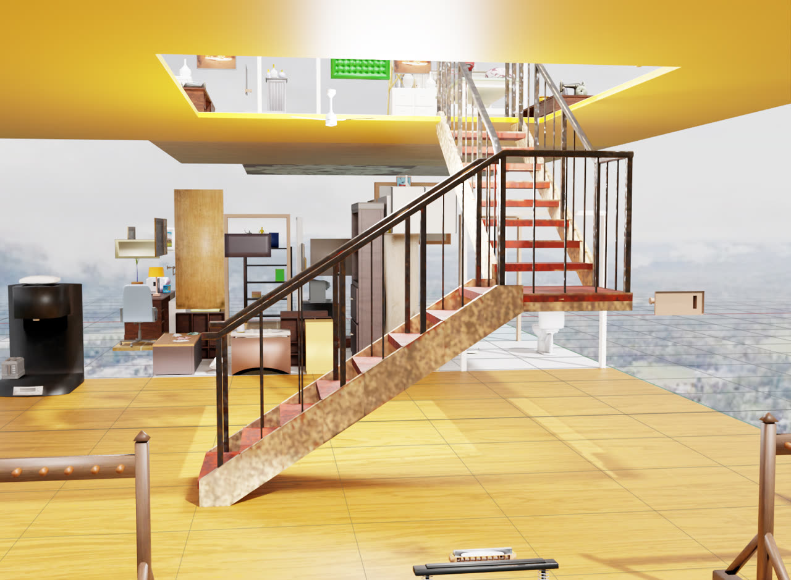 |
| **straight** | **l_shaped** | **u_shaped** |

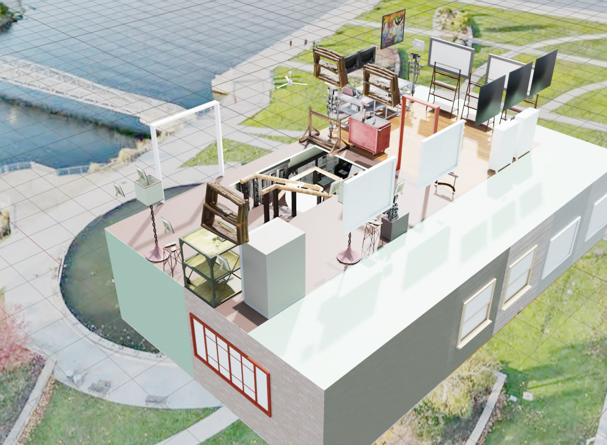

*Figure 2. Residential buildings (Cycles). Top: the three staircase families.
Bottom: a two-storey building with the upper slab cut away — the flight sits in
a furnished storey and must still clear the body proxy.*

| | |
|---|---|
| 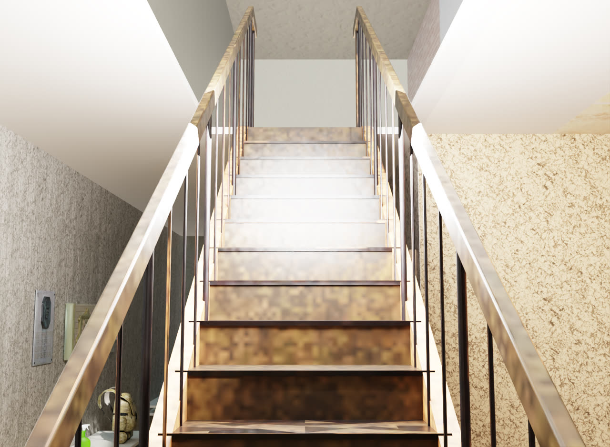 | 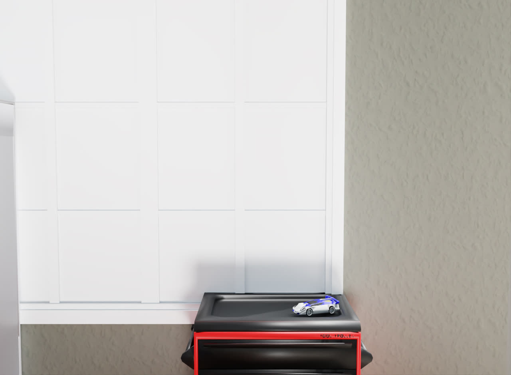 |
| **Eye level, approaching the flight** — the camera sits at 1.62 m, close to the 1.60 m height of the body proxy. | **Upper-storey arrival** — where G6 measures the last rise and G7 asks whether the storey is usable from it. |

### 3.2 Industrial pilots

Six two-storey tiled pilots, as measured on 2026-10-13.

| Building | Grid / stairs | Slab area F1 / F2 (m²) | Mezzanine coverage | Distinct scenes / equipment | Columns / truss members / roof | Standable F1 / F2 (m²) | Frozen G25 |
|---|---|---|---|---|---|---|---|
| 001 | 3×3 / 2 | 3780 / 1658 | 43.9 % | 13 / 138 | 49 / 56 / 1 | 3559 / 1562 | PASS / PASS |
| 002 | 4×4 / 2 | 6720 / 2879 | 42.8 % | 23 / 186 | 81 / 90 / 1 | 6394 / 2774 | PASS / PASS |
| 003 | 5×5 / 3 | 10500 / 4156 | 39.6 % | 35 / 225 | 121 / 132 / 1 | 10051 / 4016 | PASS / PASS |
| 004 | 3×3 / 2 | 3780 / 1653 | 43.7 % | 13 / 138 | 49 / 56 / 1 | 3555 / 1561 | PASS / PASS |
| 005 | 4×4 / 2 | 6720 / 2880 | 42.9 % | 23 / 188 | 81 / 90 / 1 | 6374 / 2771 | PASS / PASS |
| 006 | 5×5 / 3 | 10500 / 4147 | 39.5 % | 35 / 225 | 121 / 132 / 1 | 10064 / 4010 | PASS / PASS |

All six have one floor material and no repeated equipment asset (by asset
identity, not geometric similarity). **Does not support:** body-eroded routes,
physics, image quality, or acceptance of any building. On the same pilots,
Isaac Stage D passed 1 of 6 buildings, the image-quality gates excluded 34 of
52 stills, and the hall was judged visually unconvincing in all six — a large
open floor with sparse, small equipment. 0 of the 29 buildings in scope are
READY.

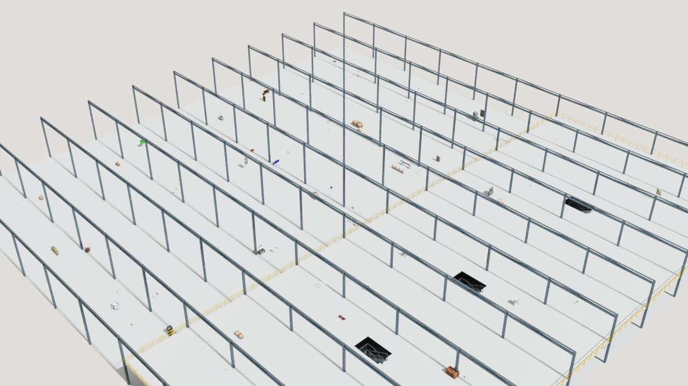

*Figure 3. Pilot 003 (5 × 5 tiles, three staircases), RTX, roof removed.
Columns and truss lines on the half-pitch grid, the mezzanine and its
guardrail, and three stairwells. The sparse equipment is the measured weakness
noted above, not an artefact of the render.*

| | |
|---|---|
| 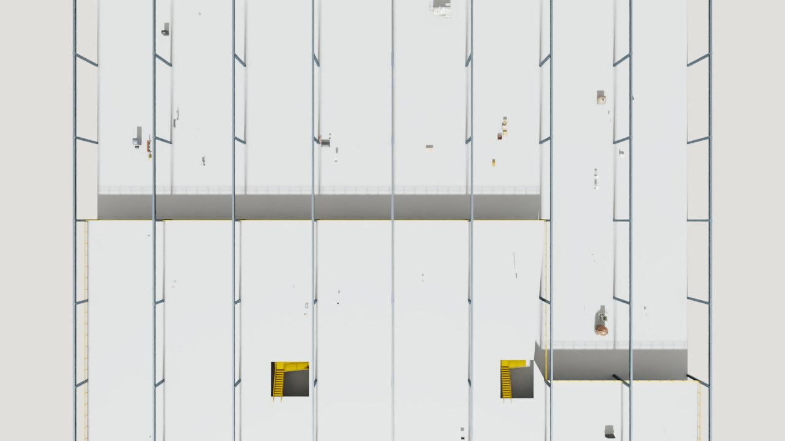 | 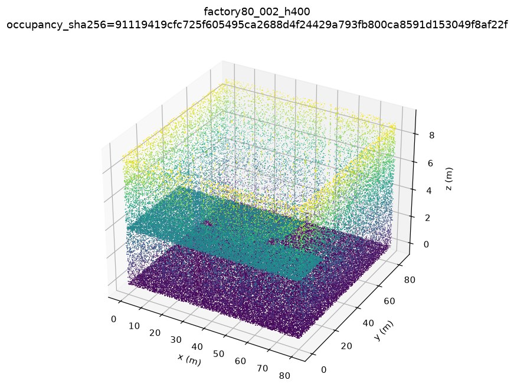 |
| **Pilot 002, top-down cut.** The L-shaped mezzanine over part of the hall, and the two stairwells cut through it. | **The same building as 5 cm occupancy.** Ground slab, mezzanine at 4 m, structure to 9 m. |

### 3.3 What the gates see

<table>
<tr>
<td width="50%">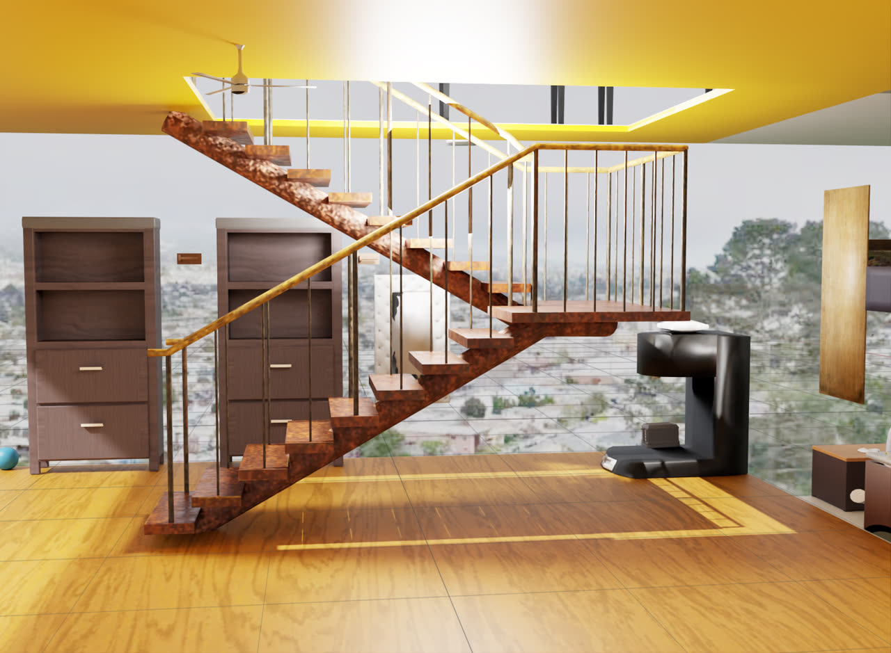</td>
<td width="50%">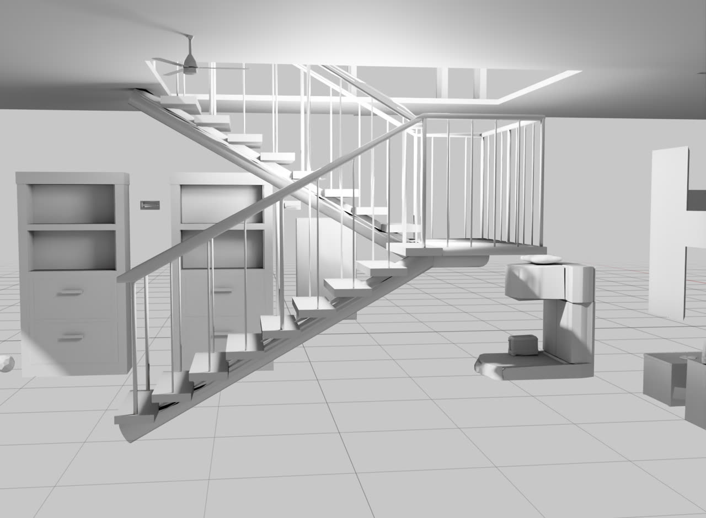</td>
</tr>
<tr><td><b>Render</b></td><td><b>Collision geometry</b></td></tr>
</table>

The same viewpoint, shaded and as colliders. Acceptance runs on the right-hand
image, never the left: a scene can look finished and still be built from convex
hulls that turn a staircase into a ramp.

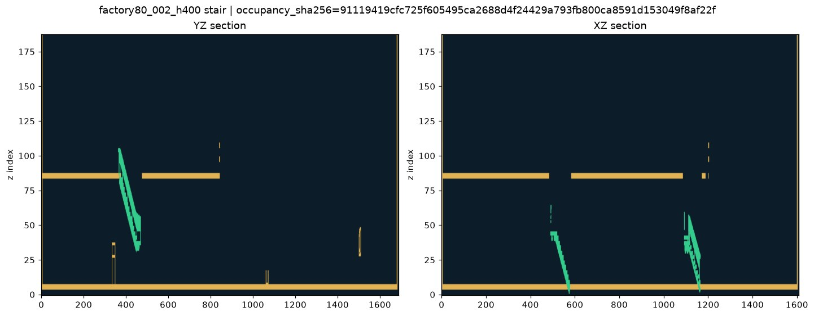

*Figure 4. Pilot 002 in section through its stairwells, in 5 cm voxel indices.
Gold: the ground slab and the mezzanine slab with its openings; green: stair
geometry.*

**Why the cache is 3D, not a height map.**

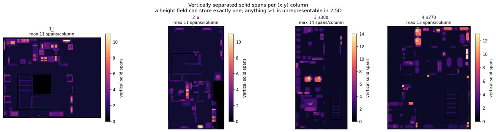

A 2.5D height field stores one surface per `(x, y)` cell. In these buildings
**17–21 % of occupied columns carry two or more vertical solid spans** — a stair
under a landing, a mezzanine over a floor, a double-height void. Those columns
are not *approximated* by a height map; they are unrepresentable in it.

| building | occupied columns | columns with ≥ 2 spans | max spans in one column |
|---|---:|---:|---:|
| `1_l` | 38,313 | 6,551 (17.1 %) | 11 |
| `2_u` | 45,082 | 7,874 (17.5 %) | 11 |
| `3_s300` | 65,668 | 13,651 (20.8 %) | 14 |
| `4_s270` | 72,897 | 12,450 (17.1 %) | 13 |

---

## 4. Limitations

- **Geometric acceptance only.** No contact dynamics, no balance, no actuation.
  A PASS says the building is not disqualified by its geometry; it does not say
  that any controller can traverse it.
- **Industrial buildings are not accepted.** The tiled pilots meet their area,
  coverage, single-material and G25 targets but fail Isaac Stage D, the
  image-quality gates and visual review (§3.2). Equipment density is the open
  problem.
- **A frozen check had a blind spot.** A negative control (N1-3) showed that
  removing every stair edge from the navigation graph does not prove that the
  storeys depend on the stairs: a non-stair opening plus a ramp kept them
  connected, and the check passed. An additional control (A3-V) now covers that
  case; it is not in the snapshot.
- **The industrial screen is textual.** Source equipment is selected by phrase
  matches on object annotations, not by measured size.
- **Two body envelopes.** Placement search uses a 0.22 m radius and 1.75 m
  height; every gate uses Standability V1 (0.25 m, 1.60 m). They are not
  interchangeable.
- **The generation snapshot is environment-bound** — absolute cluster paths,
  Isaac Sim, Blender/Infinigen, external corpora. It documents the procedure;
  re-running a step is a new run.
- **Subjective ratings are subjective.** Visual judgements are reported as such
  and never as measurements.

---

## 5. Using the library

```bash
pip install -e ".[dev]"        # core + tests
pip install -e ".[figures]"    # + matplotlib for report figures
pip install -e ".[stairs]"     # + Blender/Infinigen for detailed stair assets
```

Core needs only `numpy`, `scipy`, `trimesh`, `usd-core` and `PyYAML`. The
dependency-light stair backend (`buildingsgen.stairs.asset`) is pure OpenUSD
and is what the tests use; Infinigen is optional and gives richer assets
through the same interface.

### Command line

```bash
buildingsgen types                              # what profiles exist
buildingsgen scan    building.usd --type school
buildingsgen stairs  --rise 3.4 --type school --out stair.usda
buildingsgen connect building.usd --type school --workspace out/school_a
buildingsgen accept  --workspace out/school_a --stair-prim /World/Stair_0
buildingsgen run     building.usd --type factory      # all of the above
```

Every subcommand writes a machine-readable record under the workspace, so a
number can be cited later without rerunning anything.

### Python

```python
from buildingsgen import Workspace, load_profile, run_all

profile = load_profile("factory")
workspace = Workspace(root="out/plant_01", name="plant_01")
record = run_all("corpora/plant_01.usd", workspace, profile)

print(record["acceptance"]["status"])
for result in record["acceptance"]["results"]:
    print(result["gate"], result["status"], result["failures"])
```

```
out/plant_01/
    stages/   plant_01_connected.usda   overlay: stairs only, source untouched
              plant_01_flat.usda        composed stage the gates read
    caches/   plant_01_connected.scene_geometry_v1/
    assets/   plant_01_stair_0/stair.usda + traversal_path.json
    evidence/ scan.json connect.json bake.json acceptance.json
```

### Building types

```yaml
# src/buildingsgen/profiles/factory.yaml
name: factory
extends: generic
stair:
  families: [straight, u_shaped]
  preferred_riser_m: 0.185      # steeper industrial flights
  width_m: 1.20
  handrail: double
storeys:
  min_storey_height_m: 3.20     # tall halls, mezzanines
acceptance:
  min_reachable_area_per_storey_m2: 25.0
  max_unreachable_standable_component_m2: 3.0
```

Shipped profiles: `generic`, `house`, `factory`, `school`, `warehouse`,
`office`. Adding one is a YAML file — see [docs/building-types.md](docs/building-types.md).
Storey detection is geometric — a histogram of walkable heights, not prim
names — and a test renames the roots to prove it.

### Tests

```bash
pytest                  # unit tests and the snapshot integrity check, seconds
pytest --runslow        # + end-to-end runs on synthetic buildings, minutes
```

The slow tests build synthetic buildings with **known** defects and assert the
pipeline rejects them: a sealed slab cannot be connected, a 1.2 m ceiling is
not a storey, a 0.30 m slot does not make a storey reachable.
`tests/test_generation_snapshot.py` re-hashes `generation/` against its
manifest, and two negative controls show that it detects a changed byte and an
unlisted file.

---

## 6. Repository layout

```
src/buildingsgen/       the library
    config.py           building-type profiles, inheritance, threshold direction
    pipeline.py         scan / connect / bake / accept, and placement verification
    usd/                stage + overlay rules, colliders, geometric storey detection
    stairs/             design (spec), USD asset, placement search, Infinigen backend
    voxel/              grid, rasteriser, cache format, Standability V1
    acceptance/         gate results, context, the seven gates, runner
    fixtures/           synthetic buildings, with and without defects
    profiles/           generic, house, factory, school, warehouse, office
generation/             verbatim generator snapshot (read-only)
    house/              residential: pairing, staircases, assembly, validation, release
    factory/            industrial: sourcing, stacked chain, tiled halls
    MANIFEST.json       size, SHA-256 and origin of every file; exclusions with reasons
docs/                   architecture, building types, acceptance gates, provenance
tests/
```

Reading order: [docs/architecture.md](docs/architecture.md) for the library,
[generation/README.md](generation/README.md) for the generators.

## 7. Provenance and licence

Apache-2.0. Parts of the voxel and standability code derive from NVIDIA
ProtoMotions (Apache-2.0); the stair backends call Infinigen (BSD-3-Clause)
without vendoring it; source scenes come from MolmoSpaces and are not
redistributed. [NOTICE](NOTICE) and [docs/provenance.md](docs/provenance.md)
list every derived file and what changed; [generation/MANIFEST.json](generation/MANIFEST.json)
gives the origin of every snapshot file.

## 8. Citation

```bibtex
@software{ma2026buildingsgeneration,
  author  = {Ma, Yixing},
  title   = {{Buildings-Generation}: Simulation-Ready Multi-Storey Residential and
             Industrial Buildings with Falsifiable Geometric Acceptance},
  year    = {2026},
  version = {0.1.0},
  url     = {https://github.com/JIMMY081105/Buildings-Generation}
}
```

This work builds on:

- **Infinigen Indoors** — A. Raistrick et al., *Infinigen Indoors: Photorealistic
  Indoor Scenes using Procedural Generation*, CVPR 2024. Staircase factories.
- **Holodeck** — Y. Yang et al., *Holodeck: Language Guided Generation of 3D
  Embodied AI Environments*, CVPR 2024; and **Objaverse** — M. Deitke et al.,
  *Objaverse: A Universe of Annotated 3D Objects*, CVPR 2023. Origin of the
  `holodeck-objaverse` scenes and assets.
- **MolmoSpaces** — Allen Institute for AI, <https://huggingface.co/datasets/allenai/molmospaces>.
  Scene and object packages.
- **ProtoMotions** — NVIDIA, <https://github.com/NVlabs/ProtoMotions>. Voxel cache
  layout and standability semantics.
- **OpenUSD** — Pixar, <https://github.com/PixarAnimationStudios/OpenUSD>; and
  **NVIDIA Isaac Sim** for PhysX validation and RTX rendering.
